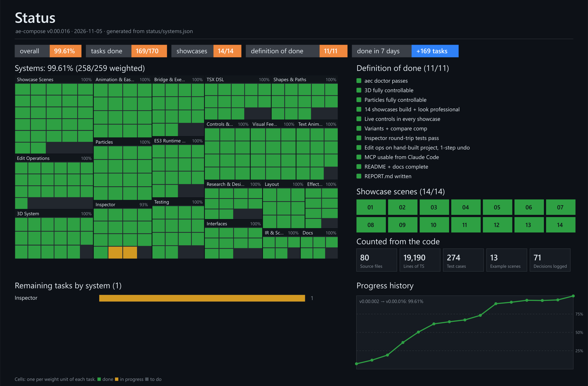

# ae-compose

**Code-first motion design for After Effects.** Claude writes Remotion-style TSX, and ae-compose compiles it into **native, fully editable After Effects comps**: real layers, eased keyframes, text animators, shape layers, effects, expression-control rigs, variants, the 3D system and particles. It also inspects and edits existing AE projects, including ripple edits, keying and placing project media. It runs on stock After Effects 2026 with no third-party plugins. A live CEP bridge, an MCP server, a CLI (`aec`) and a Claude skill drive it.

```tsx
import { scene, Composition, Solid, Text, Column, spring, perWord, control } from 'ae-compose';

export default scene({ name: 'Hello', duration: '4s', bg: '#0b0d12' }, () => (
  <Composition>
    <Solid color="#0b0d12" />
    <Column gap={30}>
      <Text font="Inter-Black" size={160} color="#eef1f6"
        animate={{ text: perWord({ from: { y: 120, opacity: 0 }, spring: { damping: control('Bounce', 12) } }) }}>
        MAKE IT MOVE
      </Text>
    </Column>
  </Composition>
));
```

`aec build hello.tsx` produces a comp `Hello_v001` in your open project. Every layer and keyframe is ordinary AE that you can grab and edit. "Bounce" is a live slider on a Controls layer and in Essential Graphics. A contact sheet and a **lint report** come back automatically. Lint flags text that's on screen too briefly to read, text cut off or outside the safe area, texts on top of each other, missing fonts and near-empty frames, each with the layer and the time.

## Status

[](status/index.html)

The image is regenerated on every release by `scripts/release.mjs` from [`status/systems.json`](status/systems.json). Interactive version: [`status/index.html`](status/index.html). Task list: [`docs/ROADMAP.md`](docs/ROADMAP.md).

## Install

Requirements:
- Windows 10/11;
- After Effects 2026 (26.x);
- Node 22+;
- pnpm (or npm);
- optional: ffmpeg on PATH (MP4/GIF previews, keying from video files).

```bash
git clone https://github.com/epol1/ae-compose && cd ae-compose
```

```bash
pnpm install
```

`pnpm install` also builds the ES3 runtime that runs inside AE (`dist/runtime/aec-runtime.jsx`).

```bash
node scripts/install-cep.mjs
```

That links the bridge extension into `%APPDATA%\Adobe\CEP\extensions`. Then enable unsigned CEP extensions once for your user:

```bash
reg add "HKCU\Software\Adobe\CSXS.12" /v PlayerDebugMode /t REG_SZ /d 1 /f
```

Restart After Effects, open a project, and check everything:

```bash
node bin/aec.mjs doctor
```

To type `aec` instead of `node bin/aec.mjs`, link it once:

```bash
pnpm link --global
```

### Setup checklist (what `aec doctor` verifies)
- [ ] After Effects 2026 found, and running with a project open
- [ ] CEP bridge extension installed (junction) and **PlayerDebugMode=1**
- [ ] Bridge reachable at `127.0.0.1:47811`. The token in `~/.ae-compose/bridge.json` is created by the extension, and requests with a browser `Origin` header are refused.
- [ ] ES3 runtime built and loading in AE
- [ ] No modal dialog blocking AE (if one is, `aec dialogs` shows it; answer it with `aec dialogs --answer <hwnd> <button>`)
- [ ] Project bit depth 8 or 16 bpc
- [ ] Inter font installed (the default font in examples; any installed font works with `font="PostScriptName"`)
- [ ] ffmpeg (optional) and sharp

If the CEP bridge isn't available, ae-compose falls back to `AfterFX.com -r` (slower, about 1 s per call).

## CLI

```text
aec doctor                                   environment + bridge checks with fixes
aec build <scene.tsx> [--variant A] [--frames 8] [--param k=v] [--reset-controls] [--no-lint]
aec watch <scene.tsx>                        rebuild on save (keeps live control values)
aec inspect [comp] [--full]                  readable outline of a comp (works on hand-built comps)
aec edit <ops.json> [--comp name]            apply edit ops (atomic, one undo step)
aec lint [comp] [--safe title] [--ignore r]  reading time, frame edges, safe areas, overlaps, fonts, blank frames
aec undo [steps]                             undo the last ae-compose build/edit (AE's own Edit > Undo)
aec snapshot [comp] --times 1,2.5            exact frames as PNG
aec sheet [comp] [--frames 12]               contact sheet
aec preview [comp] [--gif]                   short low-res MP4/GIF (review)
aec render [comp] [--format mp4|mov|prores4444|png|…] [--out path]   final file via AE's Render Queue
aec effects [query] [--describe n] [--refresh]   search the vanilla effect catalog (391 effects with params); --refresh re-harvests it from the installed AE
aec import <file>                            import footage into the project
aec dialogs [--answer <hwnd> <button>]       list/answer AE modal dialogs
aec recover [--force]                        answer known dialogs, launch AE, report a hung AE (--force kills it: unsaved work is lost)
aec eval "<extendscript>"                    escape hatch
```

Most commands accept `--json` for machine-readable output.

## MCP server (Claude Code, Claude Desktop)

The server is stdio: `node bin/aec-mcp.mjs`. This repo's `.mcp.json` registers it for Claude Code automatically:

```json
{ "mcpServers": { "ae-compose": { "command": "node", "args": ["E:/Projects/ae-mcp/bin/aec-mcp.mjs"] } } }
```

Elsewhere, register it with an absolute path:

```bash
claude mcp add ae-compose -- node "E:/Projects/ae-mcp/bin/aec-mcp.mjs"
```

For **Claude Desktop**, open Settings → Developer → Edit Config (the file is `%APPDATA%\Claude\claude_desktop_config.json`), add the server, and restart the app:

```json
{
  "mcpServers": {
    "ae-compose": { "command": "node", "args": ["E:/Projects/ae-mcp/bin/aec-mcp.mjs"] }
  }
}
```

Use the absolute path of your clone. After Effects must be running with a project open; `doctor` (a tool in both apps) checks the setup.

The server has 21 tools. Images come back as JPEG of at most 1600 px.

| Area | Tools |
|---|---|
| Build | `build_scene`, `create_variants` |
| Look | `snapshot`, `contact_sheet`, `render_preview` |
| Deliver | `render` (MP4, ProRes 422/4444, PNG/TIFF sequences, lossless AVI) |
| Inspect | `inspect_project`, `list_project_items`, `preview_item`, `inspect_comp`, `lint_comp` |
| Edit | `apply_edits` (ops include `ripple`, `place` and `key`), `undo` |
| Effects | `list_effects`, `describe_effect` |
| Media | `import_footage` |
| AE health | `doctor`, `recover_ae`, `list_dialogs`, `answer_dialog` |
| Escape hatch | `run_extendscript` |

### Claude skill
[`skills/ae-compose/SKILL.md`](skills/ae-compose/SKILL.md) (with [`recipes.md`](skills/ae-compose/recipes.md)) teaches Claude the workflow (build → look → fix → variants → edits) and motion-design rules. Use it in one of two ways:
- copy the folder to `~/.claude/skills/ae-compose/` for Claude Code;
- zip it and upload it as a skill on claude.ai.

The folder is self-contained: `reference/DSL.md` is a copy of `docs/DSL.md`, kept in sync on every release.

## 5-minute quickstart

1. Run `aec doctor`: all green (AE open with a project).
2. Build a showcase:

   ```bash
   node bin/aec.mjs build examples/01-kinetic-type/scene.tsx
   ```

   The comp opens in AE. The CLI prints the contact sheet path (`~/.ae-compose/out/KineticType/contact_main.png`) and the lint result (no warnings for this one).
3. In AE, select the **Controls** layer and drag **Word Stagger** or **Accent Color**. The animation changes live, with no rebuild.
4. Edit the TSX (for example, change a beat's `duration`) and rebuild: the comp updates in place. Your control tweaks are kept, and controls you didn't touch take the new defaults from code. Later beats ripple automatically because they're in a `<Series>`.
5. Edit any comp, even one you built by hand:

   ```bash
   node bin/aec.mjs inspect KineticType_v001
   ```

   Then apply ops, for example `[{"op":"ease","layer":"Underline","prop":"scale","easing":"easeOutBack"}]` or `[{"op":"ripple","scene":"Beat 2","by":1}]`, with `aec edit` or the `apply_edits` MCP tool. Each batch is one undo step, and it's rolled back entirely if any op fails.
6. Ask Claude (with the MCP server and skill), for example: *"make the scene at 0:03 a bit slower so we can read the text"*, or *"I greenscreened this element, add it to this comp with the controller still behind it and animate it in"*.

## Where files go

- **Final renders** (`render` tool, `aec render`): a `renders` folder next to your saved project, or `~/.ae-compose/renders/` while the project is unsaved. Pass `out` to choose a file or folder. Existing files are never overwritten (`_2`, `_3`…). Formats: H.264 MP4, ProRes 422 / 422 HQ / 4444 with alpha, PNG or TIFF sequences with alpha, lossless AVI. Note: AE clears its undo history when a script renders, so after a render earlier steps can't be undone (`undo` says so).
- **Review material** (contact sheets, frames, previews, IR): `~/.ae-compose/out/<Scene>/`, plus `_sheets`, `_snaps`, `_previews` and `_items` there.

## Showcases

Each scene in [`examples/`](examples) is built from your own assets and exposes live controls.

| # | Scene | Shows |
|---|---|---|
| 01 | [Kinetic typography](examples/01-kinetic-type/scene.tsx) | per-word/char springs, tracking reveal, `<Series>` beats, end-anchored exits |
| 02 | [Logo reveal](examples/02-logo-reveal/scene.tsx) | SVG → shape layers, trim-path draw-on, glow, matted shine |
| 03 | [Lower third](examples/03-lower-third/scene.tsx) | Essential Graphics text fields, safe-area layout, footage push-in |
| 04 | [Product promo](examples/04-product-promo/scene.tsx) | footage shots, masked card, layout, end card |
| 05 | [Data chart](examples/05-data-chart/scene.tsx) | data-driven bars, count-up labels, trend line draw-on, `plus()` staggers |
| 06 | [Vertical social ad](examples/06-vertical-social/scene.tsx) | 1080×1920 column layout, looping footage card, CTA pulse |
| 07 | [Transition pack](examples/07-transition-pack/scene.tsx) | reusable transition precomps (bar wipe, iris, slices) |
| 08 | [Variants](examples/08-variants/scene.tsx) | 3 variants + Compare comp |
| 09 | [Edit a hand-built project](examples/09-edit-existing/run.ts) | inspect, re-ease, effect, ripple, one-step undo |
| 10 | [3D product hero](examples/10-3d-product-hero/scene.tsx) | Advanced 3D, glTF model, HDRI, shadows, extrusion, orbit camera, DOF |
| 11 | [3D fly-through](examples/11-3d-flythrough/scene.tsx) | Classic 3D dolly, DOF, motion blur |
| 12 | [Particle logo reveal](examples/12-particle-logo-reveal/scene.tsx) | particle trail following a null, wipe, spark burst synced to a marker |
| 13 | [Ambient 3D particles](examples/13-ambient-3d-particles/scene.tsx) | bokeh dust following the camera, 3D carousel |
| 14 | [Particle Playground](examples/14-particle-playground/scene.tsx) | cannon fountain with gravity and live physics controls |

## Docs
- [docs/DSL.md](docs/DSL.md): the full DSL and edit-op reference
- [GOAL.md](GOAL.md): the full spec and Definition of Done
- [docs/ARCHITECTURE.md](docs/ARCHITECTURE.md): how it works (agent-first design, IR, ES3 runtime, bridge, 3D, particles)
- [docs/DECISIONS.md](docs/DECISIONS.md): every non-obvious decision, with rationale
- [docs/RESEARCH.md](docs/RESEARCH.md): verified AE 26.5 scripting facts and research summaries
- [docs/REPORT.md](docs/REPORT.md): what was built, what was verified, limits
- [docs/PROGRESS.md](docs/PROGRESS.md): current phase, next steps, open issues
- [docs/AGENT_GUIDE.md](docs/AGENT_GUIDE.md): rules for agents developing this repo

## Tests

```bash
pnpm test:unit
```

That runs the unit and codegen tests (287, Node only).

The checks below need After Effects running:

```bash
npx tsx tests/integration/roundtrip.ts
```

```bash
npx tsx tests/integration/ripple.ts
```

```bash
npx tsx tests/integration/livecontrols.ts
```

```bash
npx tsx tests/integration/ease-verify.ts
```

```bash
npx tsx tests/integration/edit-ops.ts
```

```bash
npx tsx tests/integration/renderer-seeds.ts
```

The round-trip check covers 652 properties: values, keys and eases inside groups, effects and masks, 3D, particles, Range Selector text, text on a path and camera rigs. The edit-op suite applies every op to a hand-built project and checks that one undo restores it exactly. `edit-3d.ts` (camera, light, material, geometry, particles), `gradient-edit.ts`, `render.ts` (every render format, the queue left untouched, honest undo afterwards), renderer switching, seed determinism and live controls each have their own check. `npx tsx tests/quality/compare.ts` renders the kinetic-type spec in Remotion and in AE side by side, written to [docs/quality/kinetic-compare.png](docs/quality/kinetic-compare.png).

### AE disk cache
Every snapshot and contact sheet renders frames that AE caches on disk. ae-compose purges AE's caches automatically when the disk cache passes 30 GB or the drive drops below 15 GB free (`AEC_CACHE_LIMIT_GB`; set `AEC_NO_CACHE_PURGE=1` to disable). AE clears its undo history when it purges, so this only happens when space is really tight, and the result says so. It's still worth capping **Edit > Preferences > Media & Disk Cache > Maximum Disk Cache Size** (for example 20 GB).
